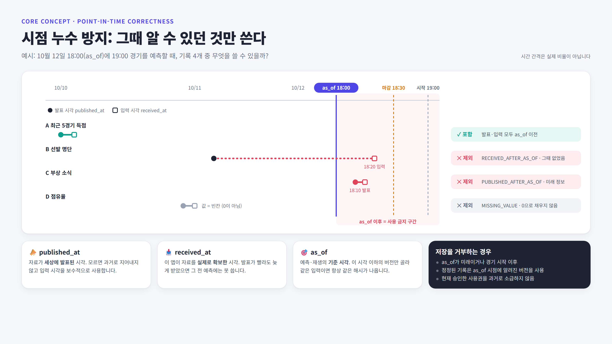

# Sports Prediction

## 그림으로 보기

그림 원본은 [docs/diagrams/](docs/diagrams/)의 HTML입니다. 내용을 고친 뒤 `.\scripts\render_diagrams.ps1`을 실행하면 docs/images/의 PNG를 다시 만듭니다(설치된 Edge 또는 Chrome 사용).

## 실행

Python 3.12 이상과 Windows PowerShell을 기준으로 합니다. 저장소 폴더에서 실행하세요.

~~~powershell
py -3.12 -m venv .venv
.\.venv\Scripts\python.exe -m pip install -r requirements.lock
.\scripts\run.ps1
~~~

이미 이 PC에는 프로젝트의 .venv와 필요한 패키지를 준비했습니다. 다시 설치할 필요 없이 마지막 명령으로 실행할 수 있습니다. 기본 주소는 http://127.0.0.1:8501입니다. 종료는 실행 터미널에서 Ctrl+C를 누릅니다.

스크립트 실행이 제한된 경우 직접 실행할 수 있습니다.

~~~powershell
.\.venv\Scripts\python.exe -m streamlit run app.py --server.address=127.0.0.1 --server.port=8501 --server.headless=true --browser.gatherUsageStats=false
~~~

8501 포트가 사용 중이면 .\scripts\run.ps1 -Port 8502처럼 다른 포트를 지정하세요. 일반 Python 설치가 없는 Codex 환경에서는 앱의 load_workspace_dependencies 도구가 알려 주는 Python으로 .venv를 만들 수 있습니다. 번들 런타임은 프로젝트의 배포 필수조건이 아닙니다.

requirements.lock은 이번에 검증한 Python 3.12 실행·테스트 환경의 버전 목록입니다. 직접 의존성은 requirements.txt, 테스트 의존성은 requirements-dev.txt에 있습니다.

## 처음 사용하는 순서

1. **데이터 소스:** 직접 작성한 자료 또는 로컬 저장 사용권이 확인된 자료의 소스 ID·이름·출처·확인 근거를 등록합니다. 권한 확인 체크가 없는 소스는 PENDING이며 입력에 사용할 수 없습니다. 소스 설정은 보존하므로 조건 변경은 새 ID로 등록합니다.
2. **경기 입력:** 직접 등록 메뉴를 사용하거나 CSV 가져오기에서 events.csv 양식을 다운로드합니다. 다섯 종목을 처음부터 선택할 수 있습니다. 골프 라운드에는 여러 선수를 등록할 수 있습니다.
4. **저장 전 확인:** 오류와 미리보기를 확인한 후 저장 버튼을 누릅니다. 한 행이라도 잘못되면 해당 파일 전체를 저장하지 않습니다.
5. **전체 경기:** 종목·리그·참가자로 검색하고 경기 상세에서 상품, 마감, 기록, 출처, 입력 시각과 예측 보류 이유를 확인합니다.
6. **가져오기 이력:** 파일명, 인코딩, 저장·중복 건수, 입력 시각과 해시를 확인합니다.

빠른 체험은 사이드바에서 **가상 예시**를 선택하고 **전 종목 가상 예시 불러오기**를 누르세요. 가상 자료는 내 데이터와 다른 DB에 저장됩니다. 다운로드하는 가상 예시 CSV의 demo 소스도 예시 저장소에서만 활성화됩니다.

## CSV 규약

양식 파일은 templates/, 가상 데이터는 examples/에도 있습니다. UI에서 내려받을 수 있습니다.

| 파일 | 목적 | 주요 규약 |
|---|---|---|
| events.csv | 경기·대회·라운드 | event_key 고유, sport 다섯 종목, event_type match/round/tournament, participants는 홈\|원정 또는 선수 목록 |
| records.csv | 발표된 수치 기록 | 참가자 이름 정확히 일치, period·published_at 필수, value 빈값은 결측이고 0은 실제 0 |
| results.csv | 경기 결과·결과 정정 | event_key, 기간·단위, 참가자별 점수 JSON, 원본 정정 식별자, expected_revision_no |
| record_corrections.csv | 기록 값 정정 | observation_id, 정정 값·발표 시각·근거, 원본 정정 식별자, expected_revision_no |

모든 행은 활성 source_id가 필요합니다. 시간은 2026-10-12T19:00:00+09:00처럼 시간대 포함 ISO 8601로 입력하며, DB는 UTC로 저장하고 화면은 Asia/Seoul로 표시합니다. 발표 시각이 불명확한 기록은 임의로 과거 시각을 부여하지 마세요.

UTF-8(BOM 포함)과 CP949를 지원하고 파일당 최대 5MB·10,000행을 허용합니다. 헤더 오류·중복 행·미등록 경기·미확인 소스·미래 발표 시각·마감 시각 오류·무한대/NaN 수치를 검사합니다. 같은 파일 또는 같은 내용의 기존 행은 건너뛰고, 같은 식별자의 다른 값은 덮어쓰지 않고 보류합니다. CSV는 초기 등록용입니다. 일정·시장 조건 변경은 변경 이력 메뉴에서 새 버전으로 입력합니다. 기록 정정은 기록 정정 화면에서 새 버전으로 입력합니다. 참가자·리그 정정과 공식 적중결과 CSV 일괄 입력은 아직 지원하지 않습니다.

## 저장과 검증

내 데이터는 data/sports.sqlite3, 가상 예시는 data/demo.sqlite3에 보관합니다. 원본 CSV 바이트, 파일 해시, 입력 시각과 감사 이력을 함께 저장하며 WAL·외래키·쓰기 트랜잭션을 사용합니다. data/와 .venv/는 Git에 포함하지 않습니다. SPORTS_DATA_DIR 환경 변수로 데이터 폴더를 별도 지정할 수 있습니다.

~~~powershell
.\.venv\Scripts\python.exe -m pytest -q
~~~

검사는 전 종목 등록·영구 저장, 원자적 입력, 중복·충돌, 시간대, 십진수 정밀도, 결측/0 구분, 소스 재검사와 Streamlit 화면의 소스 등록→CSV 저장·가상 예시·직접 등록 흐름을 확인합니다. 이번 단계에서는 예측 품질을 검증하지 않습니다.

입력 스냅샷 메뉴에서 상품과 시간대 포함 기준 시각을 선택하면 다음을 확인하고 저장할 수 있습니다.

- 기록의 published_at과 received_at이 모두 기준 시각 이하인 경우만 포함합니다.
- 결측값, 이후 발표·입력, 소스 확인이 늦거나 비활성인 기록은 제외 이유를 표시합니다.
- 사용한 버전 ID, 기록 원본 값과 ID, 제외 정보, 결정적인 입력 해시를 불변 저장하고 JSON으로 내려받습니다.

저장 모드는 INPUT_REPLAY입니다. INPUT_REPLAY 스냅샷은 모델 특징 계산 결과나 실제 사전 예측이 아니므로 운영 성능 실적으로 집계하지 않습니다. 확률도 제공하지 않습니다. 규칙을 연결해도 MODEL_UNVALIDATED 상태는 유지합니다.

## 기록 정정·결과·공식 대조

기록 정정 화면 또는 record_corrections.csv는 관측 ID의 값만 새 버전으로 정정합니다. CSV 원본, 최초 값, 이전 정정과 저장된 스냅샷을 유지합니다. 결측 정정은 빈값으로 입력합니다. 참가자·지표·기간을 바꾸는 정정은 현재 지원하지 않습니다.

결과·공식 대조 화면에서 참가자별 점수, 기간, 단위, 종료 상태, 발표 시각과 출처를 저장합니다. 종료 결과는 시작 이전에 발표된 것으로 입력할 수 없으며 모든 점수가 필요합니다. 미확정·취소·중단은 결측 점수를 허용하지만 예외 규칙이 미검토 상태여서 자동 정산하지 않습니다. 골프 선수별 결과도 저장할 수 있지만 골프 공식 상품 판정은 여전히 미지원입니다.

대조는 기준 시각까지 발표·입력된 결과와 공식 버전을 선택하고 동일한 기간·단위·시장 버전의 정상 종료 계산값을 비교합니다. 누락은 PENDING, 불일치·취소·중단·규칙 미확인·공식 출처 승인 철회·시장 버전 변경은 REVIEW_REQUIRED입니다. MATCHED도 일치 확인일 뿐 정산 확정이 아닙니다. VOID와 REFUND를 임의로 같은 판정으로 바꾸지 않으며 실제 투표권의 WIN/LOSS나 금전 지급을 계산하지 않습니다. 대조 버전과 출처·결과·규칙·시장 버전, 해시를 저장하고 JSON으로 내보냅니다.

## 목적별 사용권·모델 입력·특징

목적별 사용권 화면에서 training_features(학습용 특징 생성)와 official_results(공식 출처 확인)를 별도로 승인하거나 철회합니다. 로컬 저장 승인이 학습 권한을 의미하지 않습니다. 변경은 새 불변 버전이고 승인 입력 시각 이전에는 사용할 수 없습니다. 실제 사용 조건을 검토한 근거를 입력해야 합니다. 외부 자료에 대한 라이선스를 앱이 자동 확보하지 않습니다.

형식이 충족되면 특징 입력 상태는 READY, 부족하면 BLOCKED입니다. 모델은 여전히 UNTRAINED/UNVALIDATED이고 예측은 WITHHELD입니다. READY나 최소 sample_size=2는 성능 검증·학습 충분성·운영 활성화 기준이 아닙니다. FEATURE_REPLAY 저장본은 계약 정의, 기록 정정·사용권 버전, 원 요약값, 파생값, 기준 시각과 해시를 보존합니다. 현재 승인을 과거에 소급하지 않고, 마감·경기 시작 이후에는 특징을 저장할 수 없습니다.

자료가 있는 v2 DB는 처음 전환할 때 data/*.pre-v3.sqlite3 백업을 만들고 v3 이력을 추가합니다. 기존 ID와 저장본을 유지합니다. 기록 원본·정정·결과·공식 결과·권한·특징 계약·대조 스냅샷의 수정/삭제를 DB에서 차단합니다. 새 입력 재생은 available-records-v2로 기록하며 기존 v1 저장본의 형식과 해시는 변경하지 않습니다.

현재 테스트는 자료 정정 전후 시점 재생, 승인·철회, 정상/불일치/예외 대조, 종목별 특징·형식·충돌, 마이그레이션과 화면 저장 흐름을 확인합니다. 실제 공식 자료의 진위와 실제 모델 성능은 검증하지 않았습니다.

## 결과·정정 CSV 일괄 입력

CSV 가져오기에서 경기 결과·정정 또는 기록 정정을 선택하고 양식을 내려받습니다. results.csv의 scores_json은 {"홈팀":2,"원정팀":1} 형태의 JSON 객체이며 참가자 이름을 모두 포함하고 CSV에서는 따옴표를 이스케이프합니다. 앱의 다운로드 양식을 편집하면 CSV 인용 규칙을 유지하기 쉽습니다. 미확정 점수는 null, 완료 결과는 전원 정수입니다. 골프도 모든 등록 선수의 점수를 입력합니다.

source_id + external_id + external_revision은 소스별 원본 정정 식별자입니다. 숫자 형태 ID의 선행 0은 유지하며 external_revision은 외부 소스가 정한 문자열입니다. 같은 식별자·같은 내용은 다른 파일/인코딩으로 입력해도 건너뛰고, 내용이 다르면 EXTERNAL_REVISION_CONFLICT로 보류합니다. 새 정정에는 새 external_revision을 부여하세요.

expected_revision_no는 앱의 현재 버전입니다. 최초 결과는 0, 결과 정정은 현재 경기·기간·단위 결과 버전, 기록 정정은 관측 ID의 현재 버전을 사용합니다. 미리보기 이후 다른 입력이 먼저 수정하면 STALE_REVISION으로 파일 전체를 저장하지 않습니다. 원본 식별자가 일치하는 재입력은 정정 전 expected_revision_no가 오래되었어도 기존 입력으로 건너뛰며 현재 값을 되돌리지 않습니다. 같은 파일의 동일 결과 범위/관측 ID 정정은 한 행만 허용합니다.

현재 기록 정정 양식은 관측 ID·현재 버전·현재 값을 채워 제공합니다. 값·출처·발표 시각·external 식별자를 확인하고 빈 근거(note)를 반드시 작성하세요. 양식 다운로드만으로 정정을 저장하지 않습니다. 단순히 필드 형식이 맞는다고 출처의 실제 원본 정정 번호나 자료의 진위를 앱이 인증하지 않습니다.

파일 전체 검사 후 BEGIN IMMEDIATE 트랜잭션에서 출처·정정 버전을 재검사합니다. 결과/기록 버전, 원본 매핑, CSV 바이트·해시와 감사 이력을 함께 원자적으로 저장합니다. 오류나 쓰기 실패가 나면 한 행도 저장하지 않습니다. 이미 저장한 동일 파일은 중복 처리합니다. 공식 적중결과 CSV와 참가자·리그 정정은 아직 미지원입니다.

자료가 있는 v3 DB는 처음 전환할 때 *.pre-v4.sqlite3로 백업하며 원본 식별자→입력 버전 매핑을 추가합니다. 기존 ID·CSV·v3 스냅샷·수동 요약 계약은 유지합니다. 자동 집계는 별도 *-history-v1 계약으로 기록합니다.

## 다음 개발

첫 실제 종목은 해외축구(EPL부터)입니다. 이 저장소 안에서 Postgres·MinIO·Kafka·Spark·Airflow 기반 데이터 파이프라인을 단계적으로 추가합니다. 단계와 기술 선택 이유는 [데이터 플랫폼 로드맵](docs/de_platform_roadmap.md), 소스별 사용 조건과 역할은 [해외축구 데이터 소스 검토](docs/football_data_sources.md)를 확인하세요. 다음 구현 묶음은 로컬 인프라(Postgres, MinIO)와 openfootball(CC0) 일정·결과 배치 수집입니다. 지금은 가상 자료와 구조 검증이며 실제 모델 성능 검증·전체 예외 규칙 검토는 완료하지 않았습니다.

화면 업로드와 테스트 구현은 [Streamlit 파일 업로드 문서](https://docs.streamlit.io/develop/api-reference/widgets/st.file_uploader)와 [앱 테스트 문서](https://docs.streamlit.io/develop/api-reference/app-testing)를 참고했습니다.
