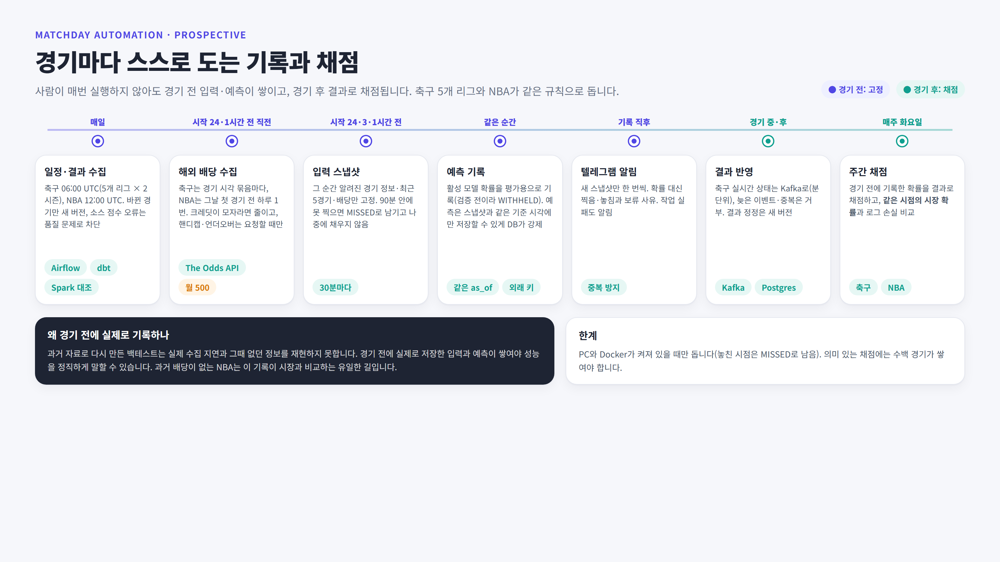

# Sports Prediction


## 그림으로 보기




그림 원본은 [docs/diagrams/](docs/diagrams/)의 HTML이고, `.\scripts\render_diagrams.ps1`로 PNG를 다시 만듭니다(설치된 Edge 또는 Chrome 사용).

## 구조

```text
openfootball(일정·결과, 자동) ─────────┐
football-data.co.uk(과거 배당 CSV) ────┼─ Airflow 매일 DAG ─┐
The Odds API(다가올 경기 배당, 자동) ──┘                    │
football-data.org(실시간 경기) ── 수집기 → Kafka → 소비자 ──┼→ Bronze(SeaweedFS S3, 원본 그대로)
                                                                  → Gold(dbt, 순위·특징·배당 확률)
                                                                  → Parquet 레이크 → Spark 재계산·대조
                                                                  → 모델 백테스트·평가 → 경기 전 스냅샷
                                                                  → 텔레그램 알림(내보내기만)
```

| 층 | 기술 | 하는 일 |
|---|---|---|
| 수집 | Python 표준 라이브러리 urllib, confluent-kafka | 소스별 요청 한도·크레딧 예산을 지키며 수집, 원본은 바이트 그대로 보존 |
| Bronze | SeaweedFS(S3 API) + boto3 | 내용 해시 경로(`sha256=….json`)로 한 번만 저장 |
| Silver | PostgreSQL 16 + psycopg 3 | `*_revisions` 버전 테이블, 수정·삭제를 트리거로 차단, `published_at`·`received_at` 두 시각으로 시점 조회(`*_known_at(as_of)`) |
| Gold | dbt-core + dbt-postgres | 순위표, 시점 특징, 마진 제거 배당 확률, 품질 테스트 26개 |
| 레이크 | Parquet(pyarrow) + Apache Spark 4 | Gold를 S3 `lake` 버킷으로 내보내고 Spark로 특징을 다시 계산해 dbt와 행 단위 대조 |
| 오케스트레이션 | Apache Airflow 3 | 매일 수집·dbt·Spark 대조, 30분마다 경기 전 스냅샷, 주간 채점 |
| 모델 | numpy(직접 구현) | 단순 비율·Poisson(ridge, 시간 감쇠)·Dixon-Coles, 주 단위 walk-forward 백테스트, 블록 부트스트랩 평가 |
| 알림 | 텔레그램 Bot API | 경기 전·주간·실패 알림, 보낸 기록으로 중복 방지 |
| 실행·검증 | Docker Compose, GitHub Actions, pytest | 모든 포트 127.0.0.1, 푸시마다 전체 테스트·Spark 테스트·dbt build |

기술별 버전과 선택 이유·대안은 [기술 스택](docs/interview/tech_stack.md)에 있습니다.

## 지키는 원칙

- **시점 누수 방지:** 모든 데이터에 발표 시각(`published_at`)·수신 시각(`received_at`)을 남기고, 예측·평가는 기준 시각(`as_of`)에 알 수 있던 것만 씁니다.
- **덮어쓰지 않기:** 원본·버전·스냅샷은 추가만 하고, DB 트리거가 수정·삭제를 막습니다. 모델·규칙·소스 버전을 예측과 함께 남깁니다.
- **모르면 보류:** 자료가 없거나 모델이 검증 기준을 통과하지 못하면 확률을 만들지 않고 `WITHHELD`와 사유를 남깁니다.

## 구현한 것

| 단계 | 내용 | 해설 |
|---|---|---|
| 1a~1d | 로컬 인프라(Postgres·SeaweedFS), openfootball 배치 수집, 배당 CSV, dbt Gold·품질 테스트, Airflow DAG, CI | [로드맵](docs/de_platform_roadmap.md) |
| 4a | Parquet 레이크, Spark 재계산, dbt와 대조 불일치 0 | [4a](docs/walkthrough/4a_spark_lake.md) |
| 4b | 텔레그램 알림(경기 전·주간·실패) | [4b](docs/walkthrough/4b_telegram_alerts.md) |
| 5a | 다섯 리그 일정·결과 수집, 팀 대조표 | [5a](docs/walkthrough/5a_multi_league.md) |
| 5b | The Odds API 해외 배당 자동 수집(경기 24·1시간 전, Pinnacle 우선) | [5b](docs/walkthrough/5b_odds_api.md) |
| 5c | 리그별 백테스트·평가·활성 모델 | [5c](docs/walkthrough/5c_league_models.md) |
| 5d-a | NBA 경기 수집(balldontlie, 2018-19~ 아홉 시즌 11,429경기, 축구와 분리한 경기 테이블, 매일 DAG) | [5d-a](docs/walkthrough/5d_nba_games.md) |

평가 결과(시험 시즌 2023-24 이후, 로그 손실이 낮을수록 좋음):

| 리그 | 모델 | 단순 비율 | 시장 비교 | 검증 |
|---|---|---|---|---|
| EPL | 0.9885 | 1.0748 | 시장이 더 정확(+0.017~0.022) | NOT_VALIDATED |
| 분데스리가 | 0.9970 | 1.0779 | 과거 배당 없음 | NOT_VALIDATED |
| 라리가 | 0.9744 | 1.0657 | 과거 배당 없음 | NOT_VALIDATED |
| 세리에A | 0.9828 | 1.0873 | 과거 배당 없음 | NOT_VALIDATED |
| 에레디비시 | 0.9694 | 1.0755 | 과거 배당 없음 | NOT_VALIDATED |

리그별 자세한 결과: [EPL](docs/reports/epl_baseline_evaluation.md) · [분데스리가](docs/reports/evaluation_de.1.md) · [라리가](docs/reports/evaluation_es.1.md) · [세리에A](docs/reports/evaluation_it.1.md) · [에레디비시](docs/reports/evaluation_nl.1.md) · [배당 가치·팀 편향 분석](docs/reports/value_and_team_bias_2026-10-21.md)

## 실행

Windows PowerShell, Python 3.12, Docker Desktop 기준입니다. 저장소 폴더에서 실행합니다.

### 1. 처음 한 번

~~~powershell
py -3.12 -m venv .venv
.\.venv\Scripts\python.exe -m pip install -r requirements.lock
.\.venv\Scripts\python.exe -m pipelines.config init-env   # 무작위 비밀번호가 든 .env 생성(Git 제외)
~~~

`.env`에 넣는 키(모두 선택, 없으면 해당 기능만 건너뜀):

| 키 | 용도 | 받는 곳 |
|---|---|---|
| `FOOTBALL_DATA_ORG_API_KEY` | 실시간 경기 상태(2단계) | football-data.org 무료 가입 |
| `THE_ODDS_API_KEY` | 다가올 경기 해외 배당(5b) | the-odds-api.com 무료 Starter |
| `BALLDONTLIE_API_KEY` | NBA 일정·결과(5d) | [balldontlie.io](https://www.balldontlie.io) 무료 가입 |
| `TELEGRAM_BOT_TOKEN`, `TELEGRAM_CHAT_ID` | 휴대폰 알림(4b) | [봇 만드는 방법](docs/walkthrough/4b_telegram_alerts.md) |

### 2. 기본 서비스와 수집

~~~powershell
docker compose --env-file .env -f infra/docker-compose.yml up -d          # Postgres·SeaweedFS·Kafka
.\.venv\Scripts\python.exe -m pipelines.db migrate
.\.venv\Scripts\python.exe -m pipelines.ingest.openfootball --league en.1 --season 2025-26
~~~

| 서비스 | 주소 |
|---|---|
| PostgreSQL | 127.0.0.1:55432 |
| SeaweedFS(S3 API) | 127.0.0.1:59000 |
| Kafka | 127.0.0.1:59092 |
| Airflow 화면 | http://127.0.0.1:58080 |

중지: `docker compose --env-file .env -f infra/docker-compose.yml down`(데이터 볼륨은 유지).

### 3. 상시 자동 실행(프로필)

~~~powershell
docker compose --env-file .env -f infra/docker-compose.yml --profile streaming up -d --build   # 실시간 수집기·소비자
docker compose --env-file .env -f infra/docker-compose.yml --profile airflow up -d --build     # Airflow
docker compose --env-file .env -f infra/docker-compose.yml exec airflow cat /opt/airflow/simple_auth_manager_passwords.json.generated
~~~

| Airflow DAG | 주기 | 하는 일 |
|---|---|---|
| `openfootball_epl_daily` | 매일 06:00 UTC | 다섯 리그 × 이전·현재 시즌 수집 → dbt build → Spark 대조 |
| `prematch_snapshots` | 30분마다 | 경기 24·1시간 전 해외 배당 수집 → 24·3·1시간 전 스냅샷·예측 기록·배당 가치 → 텔레그램 |
| `weekly_model_report` | 화요일 06:00 UTC | 경기 후 채점, 주간 보고서, 텔레그램 |
| `balldontlie_nba_daily` | 매일 12:00 UTC | NBA 현재 시즌 일정·결과(바뀐 경기만 새 버전) |

PC와 Docker Desktop이 켜져 있을 때만 돕니다. 작업이 실패하면 텔레그램으로 알립니다.

### 4. 자주 쓰는 명령

| 하고 싶은 일 | 명령 |
|---|---|
| NBA 시즌 다시 받기 | `.\.venv\Scripts\python.exe -m pipelines.ingest.balldontlie --season 2025-26` |
| 리그 백테스트 | `.\.venv\Scripts\python.exe -m pipelines.modeling.backtest --competition de.1` |
| 평가 보고서 | `.\.venv\Scripts\python.exe -m pipelines.modeling.evaluation --competition de.1 --markdown-dir docs/reports` |
| 해외 배당 지금 받기(리그당 1크레딧) | `.\.venv\Scripts\python.exe -m pipelines.ingest.the_odds_api --force en.1` |
| 앱 업데이트와 무관한 원격 제어 세션(휴대폰·웹·PowerShell에서 조작) | `.\scripts\start_remote_session.ps1` 다음 `claude attach Sports_Prediction` |
| 텔레그램 시험 | `.\.venv\Scripts\python.exe -m pipelines.notify.telegram test` |
| Spark 재계산·대조 | `docker compose --env-file .env -f infra/docker-compose.yml --profile spark run --rm spark-features` |
| 과거 배당 CSV 반영(직접 받은 파일, `data/landing/football-data-co-uk/`) | `.\.venv\Scripts\python.exe -m pipelines.ingest.football_data_co_uk` |
| dbt(별도 가상환경 `.venv-dbt`) | `.\.venv\Scripts\python.exe -m pipelines.dbt_runner build` |
| 과거 시점으로 Gold 다시 계산 | `.\.venv\Scripts\python.exe -m pipelines.dbt_runner build --vars "{as_of: '2025-01-01T00:00:00Z'}"` |

### 5. 테스트

~~~powershell
.\.venv\Scripts\python.exe -m pytest -q
~~~

서비스가 켜져 있으면 통합 테스트도 임시 DB·테스트 버킷으로 실행하고, 꺼져 있으면 건너뜁니다. GitHub Actions는 푸시마다 서비스를 띄워 전체 테스트, Spark 컨테이너 테스트, 수집→dbt 종단 실행을 합니다.

## 문서

| 문서 | 내용 |
|---|---|
| [단계별 구현 해설](docs/walkthrough/README.md) | 단계마다 무엇을 왜 만들었는지, 사용한 기술, 확인 방법, 면접 질문 |
| [면접 준비 문서](docs/interview/README.md) | 예외 처리, 메달리온, 검증 체계, 기술 스택 |
| [데이터 플랫폼 로드맵](docs/de_platform_roadmap.md) | 단계·완료 기준·사용자 선행 조건 |
| [데이터 소스 검토](docs/football_data_sources.md) | 소스별 사용 조건과 역할 |
| [코드 가이드](docs/code_guide.md) | 모듈 구조와 주요 호출 흐름 |
| [평가 보고서](docs/reports/) | 리그별 모델 평가, 배당 가치 분석 |

## 한계와 다음 계획

- **모델은 아직 검증되지 않았습니다.** EPL은 시장 배당보다 부정확했고, 다른 네 리그는 과거 배당이 없어 비교하지 못했습니다. The Odds API로 쌓이는 경기 전 배당으로 앞으로 비교합니다.
- **경기 기록(슈팅·퇴장)은 EPL만 있습니다.** 라인업·부상 정보는 쓰지 않습니다.
- **NBA는 경기 결과까지만 있습니다(5d-a).** 배당(5d-b)·모델(5d-c)·경기 전 기록(5d-d)을 차례로 붙입니다.
- **미니 PC 상시 운영(4c)**은 장비 도입 후입니다.

Football data provided by the Football-Data.org API.
