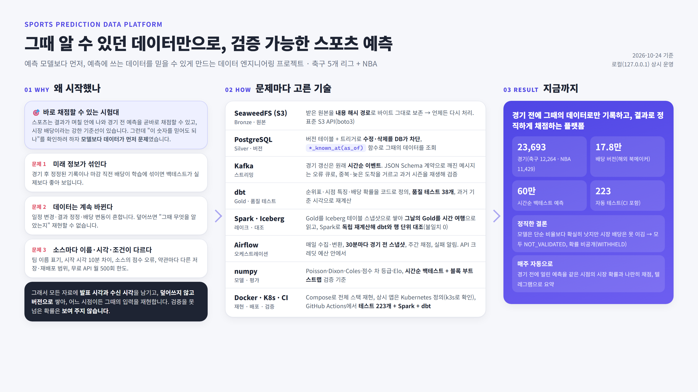
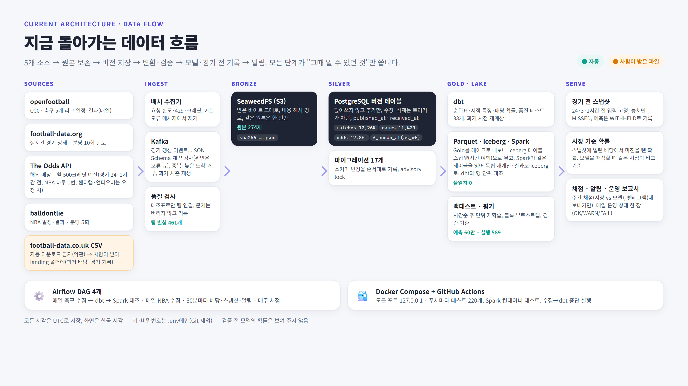
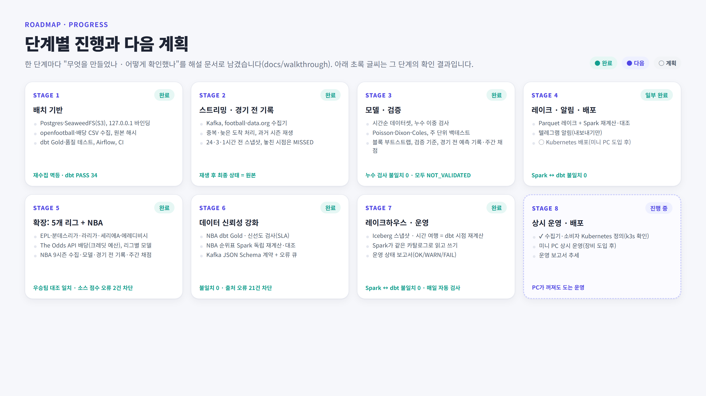

# Sports Prediction — 포트폴리오 요약

> **그때 알 수 있던 데이터만으로 예측을 기록하고, 결과로 정직하게 채점하는 데이터 플랫폼.**
> 축구 5개 리그와 NBA, 6개 데이터 소스, 로컬에서 상시 운영. 2026-10-23 기준.

## 1. 왜 이 프로젝트인가 (당위성)

### 문제: 예측 프로젝트는 대부분 데이터에서 실패한다
스포츠 예측 프로젝트는 백테스트 성적은 좋은데 실전에서는 무너지는 경우가 흔합니다. 원인은 모델보다 **데이터**에 있습니다.

- **미래 정보가 섞인다.** 경기 후 정정된 기록이나 마감 직전 배당이 학습에 들어가면, 백테스트가 실제보다 좋아 보입니다.
- **데이터가 계속 바뀐다.** 일정 변경, 결과 정정, 배당 변동이 흔해서 값을 덮어쓰면 "그때 무엇을 알았는지" 재현할 수 없습니다.
- **소스마다 다르다.** 팀 이름 표기, 시작 시각(같은 경기가 소스마다 10분 차이), 소스 자체의 점수 오류, 약관마다 다른 저장·재배포 범위가 있습니다.

이것은 스포츠만의 문제가 아닙니다. 금융 리스크, 광고, 추천처럼 **"그 시점에 알 수 있던 데이터로만 학습·평가해야 하는"** 모든 실무에서 같은 문제가 생깁니다. 피처 스토어의 시점 정합성(point-in-time correctness), 감사 가능한 이력, 데이터 계약이 그 해결책입니다.

### 왜 스포츠로 했나
스포츠는 이 문제를 검증하기 좋은 시험대입니다.

| 특성 | 그래서 좋은 점 |
|---|---|
| 데이터가 시간에 따라 바뀐다(일정·배당·정정) | 버전·시점 조회 설계가 실제로 필요하다 |
| 소스가 여러 개이고 서로 어긋난다 | 통합·대조·품질 검사를 실제로 해야 한다 |
| 결과가 며칠 안에 나온다 | 내 데이터와 예측이 맞았는지 **바로 채점**할 수 있다 |
| 시장 배당이라는 강한 기준선이 있다 | "좋아 보인다"가 아니라 **시장보다 나은가**로 검증한다 |

### 실제로 쓰는 사람이 있다

### 그래서 세운 원칙
1. **덮어쓰지 않는다.** 모든 원본과 버전은 추가만 하고, 수정·삭제는 DB 트리거가 막는다.
2. **두 개의 시각을 남긴다.** 소스가 발표한 시각(`published_at`)과 내가 받은 시각(`received_at`). 예측은 기준 시각(`as_of`) 이전에 둘 다 해당하는 것만 쓴다.
3. **경기 전에 실제로 기록한다.** 과거 재구성 백테스트와 별개로, 경기 24·3·1시간 전에 입력과 예측을 고정한다. 놓친 시점은 나중에 채우지 않는다.
4. **검증을 못 넘으면 보여 주지 않는다.** 확률은 평가용으로 저장하되, 기준을 넘기 전에는 표시하지 않는다(`WITHHELD`).

## 2. 문제 → 설계 → 증거

| 문제 | 설계 | 증거(어떻게 확인했나) |
|---|---|---|
| 미래 정보 누수 | `published_at`·`received_at`·`as_of` 세 시각, `silver.*_known_at(as_of)` 함수, 학습 경기는 "시작 + N시간 ≤ 기준 시각"을 DB CHECK로 강제 | dbt와 Python 두 구현으로 시점 특징을 따로 계산해 대조: 11,416경기 불일치 0 |
| 값이 바뀜 | Bronze(원본 해시 보존) + Silver 버전 테이블(불변 트리거) | 같은 원본 재수집 시 버전 0개 증가, 원본이 A→B→A로 돌아와도 최신 버전 복구 |
| 실시간 갱신·늦은 도착 | Kafka, DB 커밋 후 오프셋 커밋, 오래된 이벤트 거부 | 과거 시즌을 중복·늦은 도착을 섞어 재생 → 최종 상태가 원본과 일치 |
| 변환 결과를 믿을 수 있나 | dbt 품질 테스트 38개 + Spark로 독립 재계산 | Spark ↔ dbt 11,416경기 × 18열 불일치 0 |
| 소스끼리 어긋남 | 검토한 팀 대조표(461개), 시작 시각 허용 범위, 종목 규칙 검사(농구 무승부 없음) | NBA 4차 연장 경기를 동점으로 기록한 소스 오류 2건을 저장 전에 차단, 7시즌 우승팀 공개 기록과 일치 |
| 무료 API 한도 | 시점 기반 수집(경기 24·1시간 전), NBA 하루 1번, 핸디캡·언더오버는 요청할 때만 | 월 약 330 / 500크레딧 예상, 크레딧 부족 시 자동 축소 |
| 모델이 정말 좋은가 | 시간순 주 단위 재학습, 검증·시험 시즌 분리, 블록 부트스트랩, 시장과 비교하는 검증 기준 | 시험 시즌을 몇 번 봤는지까지 공개 |

## 3. 숫자

| 항목 | 값 |
|---|---|
| 경기 | 23,693(축구 12,264 · NBA 11,429) |
| 시간순 백테스트 예측 | 약 60만(실행 589개) |
| 자동 테스트 | 373개(GitHub Actions: 전체 테스트 + Spark 컨테이너 + 수집→dbt 종단) |
| 스키마 마이그레이션 | 18개 |
| Airflow DAG | 4개(매일 수집·변환·대조, 30분마다 경기 전 기록, 매주 채점) |
| 해설 문서 | 단계별 27편, 실제로 겪은 문제 기록 29건 |

## 4. 정직한 결론

- **팀 전력 모델은 단순 비율보다 확실히 낫다.** 축구 다섯 리그 모두 로그 손실 −0.08 ~ −0.11, NBA −0.078(95% 구간이 0에서 멂).
- **하지만 시장 배당은 못 이긴다.** EPL은 시장이 더 정확했고(+0.017~0.022), 다른 리그와 NBA는 과거 배당이 없어 비교하지 못했다.
- 과거 배당이 없는 종목은 경기 전에 실제로 기록한 배당·예측이 쌓이는 대로 주간 보고서에서 시장과 비교한다.

"모델이 시장을 이겼다"보다 **"이기지 못했다는 것을 데이터로 확인하고, 시스템이 그 사실을 반영하게 만들었다"**가 이 프로젝트의 결과입니다.

## 5. 실제로 겪은 문제 (일부)

| 문제 | 원인 | 해결 | 배운 점 |
|---|---|---|---|
| CI에서만 Kafka 테스트가 메시지 0개로 끝남 | 파티션 배정 전의 빈 응답까지 "다 읽음"으로 셈 | 배정 뒤부터 세고, 배정이 안 되면 조용히 끝내지 않고 오류 | "없음"과 "아직 준비 안 됨"을 구분한다 |
| Airflow 이미지 빌드가 "성공"으로 보였지만 실패 | 파이프(`\| tail`)가 종료 코드를 가림 | 출력은 파일로, 종료 코드는 따로 확인 | 배포는 결과물로 확인한다 |
| 두 번째 실행에서만 SQL 오류 | psycopg가 작은 숫자 배열을 smallint[]로 보냄 | 명시 형변환 `::bigint[]` | 멱등 경로는 따로 테스트한다 |
| 컨테이너에서만 import 실패 | 공용 부품이 Kafka 클라이언트를 끌고 옴 | 의존성 없는 모듈로 분리 | 로컬과 실행 이미지의 의존성은 다르다 |
| 소스가 4차 연장 경기를 동점으로 기록 | 3차 연장 끝 점수를 최종으로 저장 | 종목 규칙 검사(무승부 없음)로 저장 전에 차단 | 도메인 규칙을 데이터 검사로 만든다 |
| 시점 조회 테스트가 연달아 실패 | 가짜 자료의 수신 시각이 실제 현재보다 미래 | 테스트 자료를 "언제 알았나"까지 현실처럼 | 시점 코드의 테스트는 시각까지 모델링한다 |

전체 29건은 [예외 처리 기록](interview/error_handling.md)에 있습니다.

## 6. 설계 결정과 대안

| 결정 | 고른 것 | 대안과 고르지 않은 이유 |
|---|---|---|
| Silver 저장소 | PostgreSQL 버전 테이블 + 트리거 | BigQuery·Snowflake: 이 규모(수십만 행)에서 이점 없이 비용·외부 의존. Delta·Iceberg: 발표·수신 두 시각 축이 필요해 직접 설계(레이크 쪽은 다음 계획) |
| 원본 저장 | SeaweedFS(S3 API) | MinIO는 이미지 배포 중단. 코드가 boto3만 써서 AWS S3로 그대로 이전 가능 |
| 실시간 | Kafka(경기 갱신·직접 입력만) | 하루 몇 번 받는 배당은 배치로 충분해 Kafka를 거치지 않음 |
| 종목 확장 | NBA는 별도 경기 테이블 | 축구 키(리그·시즌·홈·원정)는 같은 대진이 여러 번 열리는 NBA에 맞지 않음. 규칙은 같게, 정체성만 종목에 맞춤 |
| API 예산 | 시점 기반 수집 + 요청형 수집 | 유료 요금제·계정 여러 개는 쓰지 않음(약관) |
| 표시 | 검증 기준을 넘기 전에는 확률 비공개 | "그럴듯한 숫자"를 보여 주면 판단을 왜곡 |

## 7. 면접에서 말하는 법

**30초:** "스포츠 경기 데이터를 6개 소스에서 모아, 그 시점에 알 수 있던 데이터만으로 예측을 기록하고 결과로 채점하는 플랫폼을 만들었습니다. 핵심은 발표 시각과 수신 시각을 따로 남기고 덮어쓰지 않는 버전 저장으로, 어느 시점이든 그때의 입력을 재현하는 것입니다. 모델은 시장 배당을 못 이겼고, 시스템이 그 사실을 반영해 검증 전 확률을 보여 주지 않게 했습니다."

**2분이면 더할 것:** 시점 누수를 두 구현(dbt·Python, dbt·Spark)으로 대조해 불일치 0을 확인한 방법, Kafka의 중복·늦은 도착 처리와 재생 검증, 무료 API 예산 설계, 소스 점수 오류를 도메인 규칙으로 잡은 사례.

## 8. 다음 계획

1. NBA·1X2도 dbt Gold와 Spark 대조에 넣고, 데이터 신선도 검사(SLA)를 추가
2. Kafka 이벤트 스키마 계약과 오류 큐(dead letter)
3. Iceberg 레이크하우스(스냅샷·시간 여행)로 시점 조회를 레이크까지
4. 운영 대시보드(신선도·실패·크레딧·채점), Kubernetes 배포

## 링크

[README](../README.md) · [단계별 해설](walkthrough/README.md) · [기술 스택과 선택 이유](interview/tech_stack.md) · [검증 체계](interview/validation.md) · [메달리온 구조](interview/medallion.md) · [예외 처리 기록](interview/error_handling.md) · [평가 보고서](reports/)
